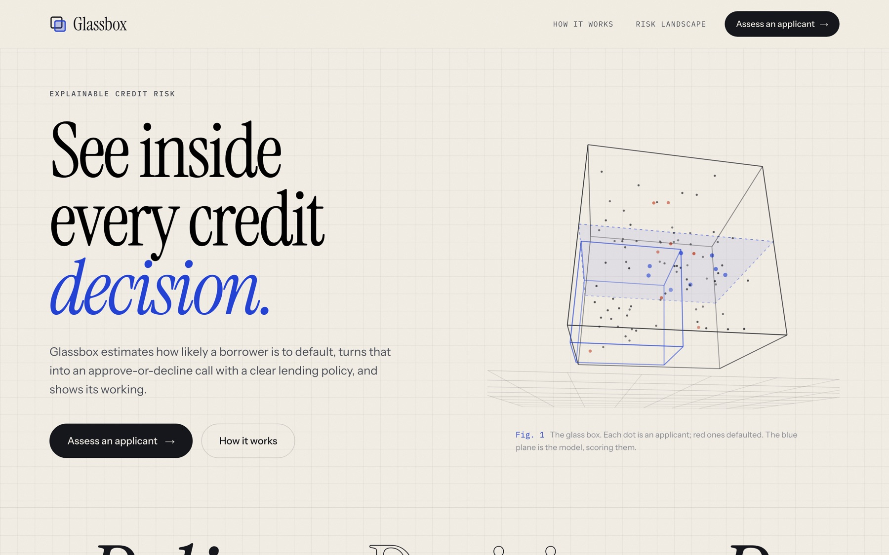
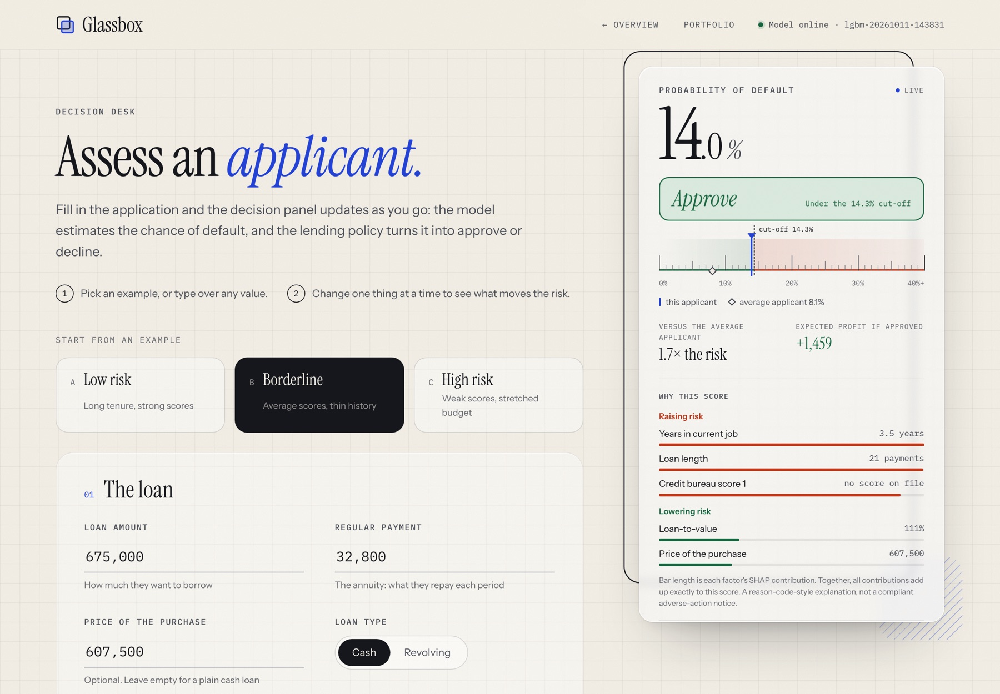
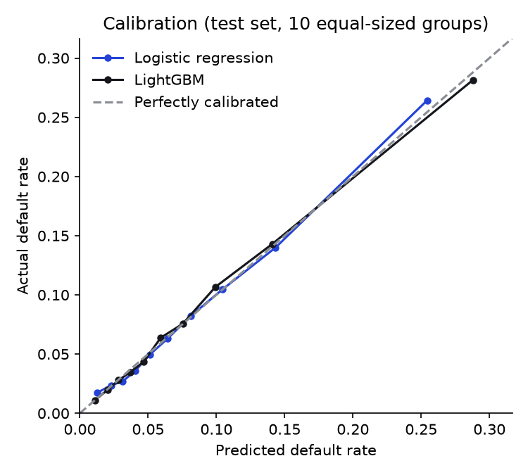
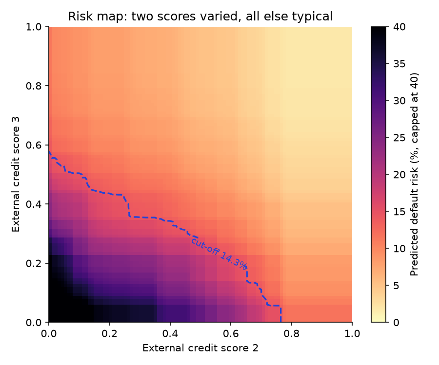
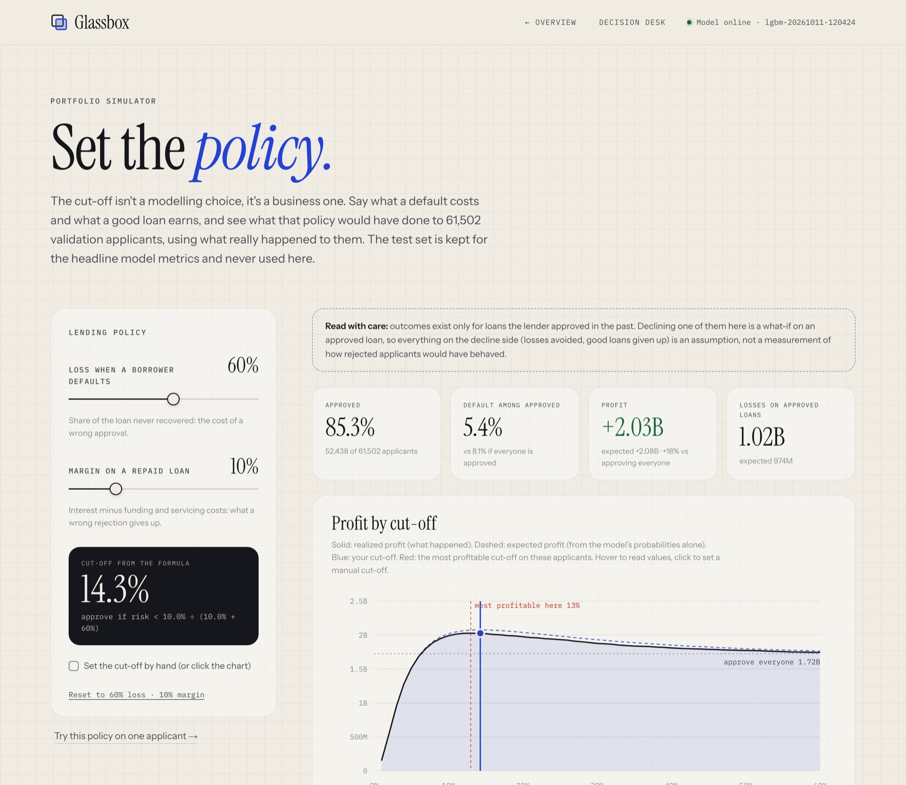
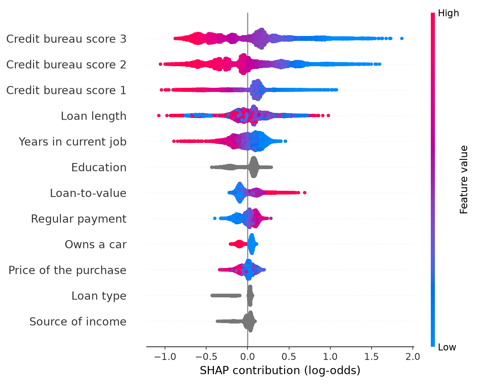

# Glassbox

**A credit-risk model you can see inside.** Glassbox predicts the probability that a loan applicant
defaults, turns it into an approve-or-decline decision with an explicit lending policy, and shows its
working: in a live decision app, and in a 3D view of the model's actual risk surface.



> **Status:** work in progress. Data, model, evaluation, reason codes, the policy simulator, the
> fairness audit, API and app are done (milestones M0–M5).
> See [docs/PLAN.md](docs/PLAN.md).

## The problem

A lender receives an application and must say yes or no. Getting the probability right is only part
of the job:

1. **Mistakes don't cost the same.** Approving a loan that defaults can lose most of it; turning away
   someone who would have repaid loses only the margin. A 50% cut-off ignores that.
2. **Decisions must be explainable.** In the US, a lender that declines someone must give the principal
   reasons (ECOA / Regulation B adverse action notices).
3. **Decisions must be fair, and that has to be measured.** Leaving gender and age out of the model is
   not enough when other inputs can stand in for them.

Glassbox is built around those three points, on the public
[Home Credit Default Risk](https://www.kaggle.com/competitions/home-credit-default-risk) data
(307,511 past applicants, 8.1% defaulted).

## What it does today



- **Model:** LightGBM on 15 application fields plus 5 engineered ratios (payment-to-income,
  loan-to-value, ...). A higher credit score can never raise predicted risk (monotone constraints).
- **Reason codes:** every prediction comes with the factors that raised and lowered the risk,
  measured with SHAP. On a decline they are the principal reasons an adverse action notice would list.
- **Policy:** approve when expected profit is positive: `p < margin / (margin + loss given default)`.
  With placeholder economics (60% loss on default, 10% margin) the cut-off is **14.3%**.
- **Portfolio simulator:** set the loss and the margin (or a manual cut-off) and replay the policy on
  61,502 validation applicants with known outcomes: approval rate, defaults, expected and realized
  losses and profit, a profit curve across cut-offs, a calibration table and the fairness check. The
  decision desk uses the same policy.
- **API (FastAPI):** `POST /predict` (score, decision, reasons, expected profit), `POST /portfolio/simulate`,
  `GET /model/info`, `GET /model/surface`. Docs at `/docs`.
- **App (React + TypeScript):** a landing page and a live decision desk. The decision updates as
  you type; three example applicants (low risk, borderline just under the cut-off, high risk) are one click away.

## Results

Held-out **test set** (61,503 applicants), scored once, after the model was chosen on validation.

| Model | ROC-AUC | Gini | PR-AUC | KS | Brier | Calibration error |
|---|---|---|---|---|---|---|
| Logistic regression (baseline) | 0.745 | 0.490 | 0.231 | 0.363 | 0.0685 | 0.3 pts |
| **LightGBM (served)** | **0.763** | **0.526** | **0.250** | **0.394** | **0.0676** | **0.3 pts** |

A random model scores ROC-AUC 0.5 and PR-AUC 0.081 (the default rate).

<p>
  
  
</p>

- **Calibration:** averaged over deciles, predicted and actual default rates differ by 0.3 points on
  test and 0.6 on validation; near the cut-off, by up to about a point (decile table below). No extra
  calibration step was added; the cut-off formula uses the probabilities directly.
- **The risk map** (right) is the served model with two credit scores varied and everything else held
  at a typical applicant. Steps come from tree thresholds; risk only falls towards higher scores
  (the monotone constraint); the dashed line is the policy cut-off.
- **20 features vs. all 117:** the curated set scored 0.758 validation ROC-AUC vs. 0.753 for every raw
  column, likely thanks to the engineered ratios
  ([notebook 02](notebooks/02_feature_set_tradeoff.ipynb)). The small set makes the form usable and the
  reasons readable, at no cost in accuracy.

### The policy, in money



The simulator replays a policy on the **validation** cohort (61,502 applicants with known outcomes);
the test set is never used interactively. At the default policy (60% loss, 10% margin):

| Rule | Cut-off | Approved | Default among approved | Expected profit | Realized profit |
|---|---|---|---|---|---|
| **Cost-based policy** | **14.3%** | **85.3%** | **5.41%** | **+2.08B** | **+2.03B** |
| Approve everyone | none | 100% | 8.07% | +1.74B | +1.72B |
| 50% cut-off | 50% | 99.4% | 7.81% | +1.80B | +1.77B |

- **Expected** figures use only the model's probabilities; **realized** ones use what happened. Expected
  losses on approved loans were 0.97B against 1.02B realized: the model is about 4% optimistic on losses.
- The most profitable cut-off on this cohort is 13%, a point below the formula's 14.3%, consistent with
  the slight under-prediction around the cut-off shown below.
- A 50% cut-off barely differs from approving everyone: almost nobody scores above 50%.
- **Selection bias:** outcomes exist only for loans the lender approved. Declining one of them here is a
  what-if on an approved loan, so decline-side results (losses avoided, profit given up) are assumptions,
  not measurements of how rejected applicants would behave.
- Profit is in the dataset's unnamed currency, with no timing, prepayment or partial recoveries.

**Calibration by decile** (served model, test set, scored once). The cut-off formula is only as good as
the probabilities near the cut-off, so a single average error is not enough evidence:

| Decile | Predictions | Average prediction | Actual default rate (± 1 SE) |
|---|---|---|---|
| 1 | 0.1–1.6% | 1.1% | 1.1% ± 0.1 |
| 2 | 1.6–2.4% | 2.0% | 2.0% ± 0.2 |
| 3 | 2.4–3.2% | 2.8% | 2.8% ± 0.2 |
| 4 | 3.2–4.2% | 3.7% | 3.5% ± 0.2 |
| 5 | 4.2–5.3% | 4.7% | 4.4% ± 0.3 |
| 6 | 5.3–6.7% | 5.9% | 6.4% ± 0.3 |
| 7 | 6.7–8.6% | 7.5% | 7.6% ± 0.3 |
| 8 | 8.6–11.5% | 9.9% | 10.7% ± 0.4 |
| 9 | 11.5–17.5% | 14.1% | 14.3% ± 0.4 |
| 10 | 17.5–83.4% | 28.8% | 28.1% ± 0.6 |

The 14.3% cut-off falls in decile 9. There, test agrees closely (14.1% predicted, 14.3% actual), while
validation shows a 1.2-point under-prediction (14.4% vs 15.6% ± 0.5). The top decile is over-predicted
on validation (29.0% vs 26.3%). Fair summary: near the cut-off the probabilities hold to within about a
point, so the cut-off itself is uncertain by about that much. Both tables: [reports/metrics.json](reports/metrics.json).

### Fairness audit

Gender and age are not model inputs; they were kept aside only for this audit. Results at the default
14.3% cut-off on the **validation** cohort (61,502 applicants; the test set is reserved for the headline
metrics). Full numbers: [reports/fairness.json](reports/fairness.json).

| Group | Applicants | Actual default rate | Model's average prediction | Approved | Approval ratio¹ | Repayers declined² |
|---|---|---|---|---|---|---|
| Women | 40,529 | 7.0% | 7.5% | 87.3% | 1.00 | 10.7% |
| Men | 20,972 | 10.1% | 9.2% | 81.4% | 0.93 | 15.5% |
| Under 30 | 8,972 | 11.3% | 12.9% | 69.1% | **0.72** | 26.9% |
| 30–44 | 24,859 | 9.1% | 8.5% | 83.8% | 0.88 | 13.4% |
| 45–59 | 20,719 | 6.5% | 6.6% | 90.5% | 0.95 | 7.9% |
| 60+ | 6,952 | 4.8% | 5.0% | 95.7% | 1.00 | 3.6% |

¹ Approval rate relative to the most-approved group in the same table; below 0.8 is the common
"four-fifths" warning sign (a rule of thumb, not a legal test). ² Share of applicants who did repay but
would have been declined.

What this shows:
- **Most of the approval gaps follow different default rates.** Men and younger applicants default more
  often, so a single cut-off approves them less. The gender ratio (0.93) is above the four-fifths line.
- **Under-30s fall below it (0.72), and not only because of their base rate.** The model overstates their
  risk: it predicts 12.9% on average against 11.3% observed (standard error ≈ 0.3 points). Over a quarter
  of under-30s who repaid would have been declined, against 4% of over-60s.
- **Calibration differs by gender too:** the model overstates women's risk (7.5% vs 7.0%) and understates
  men's (9.2% vs 10.1%), each about four standard errors. With gender excluded, the model cannot tell the
  groups apart, so it lands between them.
- **Removing age didn't remove age.** The "not employed" flag marks pensioners: 83% of over-60s carry it,
  against 0.8% of under-45s. The model gives that flag the least weight of all 20 features (SHAP), but
  years in current job, the 5th most important feature, also tracks age.

What it doesn't show: whether any gap is legally justified (this is not a legal analysis), how the
model treats applicants the lender rejected in the past (their outcomes don't exist), or anything about
race or ethnicity (not in the data). Mitigations such as per-group calibration checks, reweighting or
constrained training are discussed, not built.

### What drives the model (SHAP)



Each dot is one test applicant; right of zero raises predicted risk, left lowers it; colour is the
feature's value (grey for text categories). The three credit-bureau scores dominate, and high scores
(red) always sit on the left: the monotone constraint at work. Loan length is non-linear: both short
and long loans can raise risk. SHAP contributions are exact for tree models and add up to the model's
score, which a test checks.

More: [ROC](reports/figures/roc.png), [global importance](reports/figures/shap_importance.png), [precision-recall](reports/figures/precision_recall.png),
[all metrics](reports/metrics.json), [exploratory analysis](notebooks/01_eda.ipynb).

## Design decisions

| Decision | Why |
|---|---|
| No accuracy metric | Approving everyone is 92% "accurate" and catches no defaults. |
| No class weights or resampling | They distort probabilities; imbalance is handled by the cut-off instead. |
| Early stopping on log loss, not AUC | Log loss rewards honest probabilities, not just a good ranking. |
| Monotone constraints on credit scores | Explanations stay intuitive; it's what model-risk reviewers expect. |
| Feature engineering inside the saved pipeline | Training and the API compute features identically. A test caught a real train/serve skew bug: a JSON `null` became a text column that LightGBM rejected. |
| Gender, age, marital status excluded from the model, kept for the audit | Mirrors US fair-lending rules. EDA found the "not employed" flag is mostly pensioners, i.e. an age proxy, so the audit has to look for proxies. |
| Model chosen on validation, test set scored once | Keeps the reported numbers honest. |
| Cut-off from economics, not 0.5 | The policy is a business input; the simulator shows its effect on unseen applicants. |
| SHAP TreeExplainer for reasons | Exact for trees, additive (contributions sum to the score), ~3 ms per applicant, so it runs live on every request. |

## Limitations

- **No time-based split.** The data has no application dates, so the split is random (stratified).
  In production I'd train on older loans, validate on newer ones, and monitor drift.
- **Selection bias.** Outcomes exist only for loans Home Credit approved. We never see how rejected
  applicants would have done, which also limits any fairness conclusion.
- **One lender, one market.** Not US data, consumer cash and revolving loans only; the currency and the payment period are
  undocumented, so ratios are relative signals.
- **Placeholder economics.** 60% loss and 10% margin are assumptions; real values vary per loan, and
  the simulator ignores timing, prepayment and partial recoveries.
- **Approve-everyone looks profitable** because the test loans were already approved by Home Credit;
  the people it rejected are missing, so every baseline here is flattered.
- **Opaque inputs.** The three external scores are the strongest features, and their provenance is unknown.
- **Reason codes explain the model, not the world.** SHAP is not causal, and correlated inputs (the
  three scores; loan amount and purchase price) can share credit in ways that look arbitrary.
- **Fairness audit is descriptive.** It measures gaps at one cut-off on past approved loans; it does not
  fix them, and it is not a legal disparate-impact analysis.

## Run it locally

Needs Python 3.12+, Node 20+, and on macOS `brew install libomp` (for LightGBM).

1. **Data** (not in the repo; Kaggle's terms restrict redistribution): log in to Kaggle, open the
   [competition data page](https://www.kaggle.com/competitions/home-credit-default-risk/data), accept
   the rules, download `application_train.csv` and put it, zipped or not, in `data/raw/`.
2. **Install and train** (training takes about 10 seconds):
   ```bash
   python3 -m venv .venv && source .venv/bin/activate
   pip install -e ".[dev]"
   python -m credit_risk.train
   ```
3. **Run the API and the app**, in two terminals:
   ```bash
   uvicorn api.main:app --reload
   ```
   ```bash
   cd web && npm install && npm run dev
   ```
   Open http://localhost:5173. Pages: `/` (overview), `/assess` (decision desk), `/portfolio` (simulator).

Tests need no data download: `pytest` (41 tests: cleaning and split, features, the monotone
constraint, metrics, SHAP additivity and reason codes, threshold and portfolio maths, and the API
contract, all on synthetic data).

## Repository layout

```
src/credit_risk/   data.py, features.py, models.py, train.py, evaluate.py, explain.py, decision.py, whatif.py
api/               FastAPI app and request/response schemas
web/               React + TypeScript app (Vite)
tests/             pytest suite (synthetic data)
notebooks/         01 exploratory analysis, 02 feature-set trade-off
reports/           metrics.json and figures (aggregates only)
docs/              plan and screenshots
```

Built with Python, pandas, scikit-learn, LightGBM, FastAPI, React and TypeScript. The 3D views are
drawn by a ~100-line canvas renderer (`web/src/wire3d.ts`), no 3D library.
