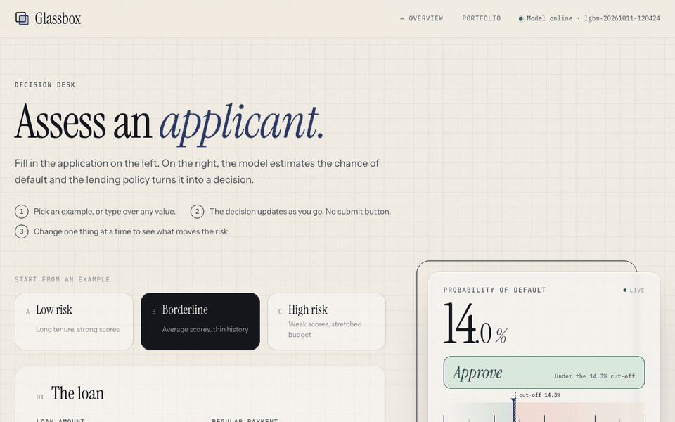

# Glassbox

[](https://github.com/YOAV-DORY/glassbox/actions/workflows/ci.yml)

[](LICENSE)

**A credit-risk model you can see inside.** A student portfolio project: Glassbox predicts the
probability that a loan applicant defaults, turns it into an approve-or-decline decision with an
explicit lending policy, explains each decision, and audits the outcome across groups. It is a learning
project on public data, not a lending product, and the sections below say where its evidence stops.

**Live demo: https://glassbox-uayo.onrender.com** (synthetic-data model, so its numbers are
illustrative; the real results are below. On the free plan the server sleeps when idle, so the
first visit can take up to a minute to wake it.)


**Demo (68 s):** the decision desk reacting to a falling credit score, then the policy simulator.



> **Status**
> - **Done:** data pipeline, baseline and LightGBM models with test-set confidence intervals, decile
>   calibration, SHAP reason codes, cost-based policy and portfolio simulator, fairness audit by gender
>   and age, API, web app, synthetic-data demo (script and Docker), CI.
> - **Not done:** out-of-time validation (the data has no dates), reject inference, any fairness
>   mitigation, monitoring, a deployed instance. See [docs/PLAN.md](docs/PLAN.md) for the original plan.

## The problem

A lender receives an application and must say yes or no. Getting the probability right is only part
of the job:

1. **Mistakes don't cost the same.** Approving a loan that defaults can lose most of it; turning away
   someone who would have repaid loses only the margin. A 50% cut-off ignores that.
2. **Decisions must be explainable.** Lenders are expected to explain declines (in the US, through
   adverse action notices under ECOA / Regulation B).
3. **Decisions must be fair, and that has to be measured.** Leaving gender and age out of the model is
   not enough when other inputs can stand in for them.

Glassbox is built around those three points, on the public
[Home Credit Default Risk](https://www.kaggle.com/competitions/home-credit-default-risk) data
(307,511 past applicants, 8.1% defaulted).

## What it does today


- **Model:** LightGBM on 15 application fields plus 5 engineered ratios (payment-to-income,
  loan-to-value, ...). A higher credit score can never raise predicted risk (monotone constraints).
- **Reason codes:** every prediction comes with the factors that raised and lowered the risk,
  measured with SHAP. These are reason-code-style explanations, not a compliant adverse-action notice:
  a real notice needs reviewed reason wording, a stable mapping from features to reasons, and legal review.
- **Policy:** approve when expected profit is positive: `p < margin / (margin + loss given default)`.
  With placeholder economics (60% loss on default, 10% margin) the cut-off is **14.3%**.
- **Portfolio simulator:** set the loss and the margin (or a manual cut-off) and replay the policy on
  61,502 validation applicants with known outcomes: approval rate, defaults, expected and realized
  losses and profit, a profit curve across cut-offs, a calibration table and the fairness check. The
  decision desk uses the same policy.
- **API (FastAPI):** `POST /predict` (score, decision, reasons, expected profit), `POST /portfolio/simulate`,
  `GET /model/info`, `GET /model/surface`. Docs at `/docs`.
- **App (React + TypeScript):** a landing page and a live decision desk. The decision updates as
  you type; three example applicants (low risk, borderline just under the cut-off, high risk) are one click away.

## Results

Held-out **test set** (61,503 applicants), scored once, after the model was chosen on validation.

| Model | ROC-AUC [95% CI] | Gini | PR-AUC | KS | Brier | Calibration error |
|---|---|---|---|---|---|---|
| Logistic regression (baseline) | 0.745 [0.738, 0.751] | 0.490 | 0.231 | 0.363 | 0.0685 | 0.3 pts |
| **LightGBM (served)** | **0.763 [0.756, 0.769]** | **0.526** | **0.250** | **0.394** | **0.0676** | **0.3 pts** |

A random model scores ROC-AUC 0.5 and PR-AUC 0.081 (the default rate). Intervals come from a paired
bootstrap over the test applicants (1,000 resamples, no refitting).

- **LightGBM's edge over the baseline is small but real for this test set:** +0.018 AUC, 95% CI
  [+0.016, +0.021]. The interval covers sampling noise in the test applicants only, not how much either
  model would change if retrained on a different training sample. A linear model with sensible features
  gets most of the way there.

<p>
  
  
</p>

- **Calibration:** averaged over deciles, predicted and actual default rates differ by 0.3 points on
  test and 0.6 on validation; near the cut-off, by up to about a point (decile table below). No extra
  calibration step was added; the cut-off formula uses the probabilities directly.
- **The risk map** (right) is the served model with two credit scores varied and everything else held
  at a typical applicant. Steps come from tree thresholds; risk only falls towards higher scores
  (the monotone constraint); the dashed line is the policy cut-off.
- **20 features vs. all 117:** on validation the curated set scored 0.758 against 0.753 for every raw
  column (+0.006, CI [+0.003, +0.009]), and removing its four engineered ratios cost 0.009 (CI [+0.007,
  +0.011]) ([notebook 02](notebooks/02_feature_set_tradeoff.ipynb)). So the small set loses nothing here
  and the ratios account for its slight edge; both differences are under 0.01 AUC, from one split.

More: [ROC](reports/figures/roc.png), [global importance](reports/figures/shap_importance.png), [precision-recall](reports/figures/precision_recall.png),
[all metrics](reports/metrics.json), [exploratory analysis](notebooks/01_eda.ipynb).

## Design decisions

| Decision | Why |
|---|---|
| No accuracy metric | Approving everyone is 92% "accurate" and catches no defaults. |
| No class weights or resampling | They distort probabilities; imbalance is handled by the cut-off instead. |
| Early stopping on log loss, not AUC | Log loss rewards honest probabilities, not just a good ranking. |
| Monotone constraints on credit scores | Explanations stay intuitive: a better score never raises risk (tested). Their accuracy cost was not measured separately. |
| Feature engineering inside the saved pipeline | Training and the API compute features identically. A test caught a real train/serve skew bug: a JSON `null` became a text column that LightGBM rejected. |
| Gender, age, marital status excluded from the model, kept for the audit | Mirrors US fair-lending rules. EDA found the "not employed" flag is mostly pensioners, i.e. an age proxy, so the audit has to look for proxies. |
| Model chosen on validation, test set scored once | Keeps the reported numbers honest. |
| Cut-off from economics, not 0.5 | The policy is a business input; the simulator shows its effect on validation applicants. |
| Interactive analysis on validation only | The simulator and fairness view let you search over cut-offs; doing that on the test set would leak, so test is reserved for the headline metrics. |
| A synthetic-data demo, labelled as such | Anyone can run the full app in one command without the Kaggle download, and can't mistake its numbers for results. |
| SHAP TreeExplainer for reasons | Exact for trees, additive (contributions sum to the score), ~3 ms per applicant, so it runs live on every request. |

## Limitations

- **No time-based split.** The data has no application dates, so the split is random (stratified).
  Real performance on future applicants is likely lower than the test numbers suggest.
- **Selection bias.** Outcomes exist only for loans Home Credit approved. We never see how rejected
  applicants would have done, which also limits any fairness conclusion.
- **One lender, one market.** Not US data, consumer cash and revolving loans only; the currency and the payment period are
  undocumented, so ratios are relative signals.
- **Placeholder economics.** 60% loss and 10% margin are assumptions; real values vary per loan, and
  the simulator ignores timing, prepayment and partial recoveries.
- **Approve-everyone looks profitable** because every loan in the data was already approved by Home
  Credit; the people it rejected are missing, so every baseline here is flattered.
- **Opaque inputs.** The three external scores are the strongest features, and their provenance is unknown.
- **Reason codes explain the model, not the world.** They are not an adverse-action notice. SHAP is
  not causal, and correlated inputs (the
  three scores; loan amount and purchase price) can share credit in ways that look arbitrary.
- **Fairness audit is descriptive.** It measures gaps at one cut-off on past approved loans; it does not
  fix them, and it is not a legal disparate-impact analysis.
- **Uncertainty is partly measured.** Confidence intervals cover sampling noise in the evaluation
  applicants, not variation from retraining on other samples or from a different time period.

## What I'd do with production data

- **Validate out of time:** train on older vintages, test on newer ones, and track performance by vintage.
- **Monitor:** score drift (population stability index), calibration by decile and by segment, and the
  fairness table on live decisions, with alerts before the cut-off's assumptions break.
- **Handle reject inference:** use declined applicants' later bureau outcomes, or a small randomised
  approval band, to learn how the model does on people the old policy turned away.
- **Price per loan:** replace the single loss and margin with per-product estimates (term, rate,
  recoveries, funding cost), so the cut-off differs where the economics differ.
- **Govern the reason codes:** a reviewed mapping from features to approved reason statements, tested for
  stability, before anything like an adverse-action notice is generated.

## Try it in one command (no Kaggle download)

Or skip installing and use the [live demo](https://glassbox-uayo.onrender.com), which runs the same thing.

A demo model trained on **synthetic** applicants (generated in code, same format as the real data),
served with the full web app on http://localhost:8000. Its numbers are illustrative; the app says so.

```bash
./scripts/demo.sh          # needs Python 3.11+ and Node 20+ (macOS: brew install libomp)
```

or, with Docker only:

```bash
docker build -t glassbox . && docker run --rm -p 8000:8000 glassbox
```

## Run it locally with the real data

Needs Python 3.11+, Node 20+, and on macOS `brew install libomp` (for LightGBM). To reproduce the exact
library versions behind the published numbers (Python 3.12+), add `-c constraints.txt` to the install.

1. **Data** (not in the repo; Kaggle's terms restrict redistribution): log in to Kaggle, open the
   [competition data page](https://www.kaggle.com/competitions/home-credit-default-risk/data), accept
   the rules, download `application_train.csv` and put it, zipped or not, in `data/raw/`.
2. **Install and train** (training takes about 10 seconds):
   ```bash
   python3 -m venv .venv && source .venv/bin/activate
   pip install -e ".[dev]"
   python -m credit_risk.train
   ```
3. **Run the API and the app**, in two terminals:
   ```bash
   uvicorn api.main:app --reload
   ```
   ```bash
   cd web && npm install && npm run dev
   ```
   Open http://localhost:5173. Pages: `/` (overview), `/assess` (decision desk), `/portfolio` (simulator).

Tests need no data download: `pytest` runs 53 tests on synthetic data: cleaning and split, features,
the monotone constraint, metrics and bootstrap intervals, SHAP additivity and reason codes, threshold
and portfolio maths, the fairness audit, the API contract, the `metrics.json` schema, and an end-to-end
test that trains with the real training code and serves the result through the production server.
CI runs them on Python 3.11 and 3.13, plus lint, the web build, the demo and the Docker image.

## Repository layout

```
src/credit_risk/   data, features, models, train, evaluate, explain, decision, fairness, whatif,
                   reports (metrics schema), synthetic + demo (no-download demo)
api/               main.py (API), schemas.py, serve.py (API + built web app on one port)
web/               React + TypeScript app (Vite)
tests/             pytest suite (synthetic data only)
notebooks/         01 exploratory analysis, 02 feature-set trade-off with ablation
reports/           metrics.json, fairness.json and figures (aggregates only)
scripts/demo.sh    one-command demo;  Dockerfile: the same in a container
docs/              plan, screenshots and the demo GIF
```

Built with Python, pandas, scikit-learn, LightGBM, FastAPI, React and TypeScript. The 3D views are
drawn by a ~100-line canvas renderer (`web/src/wire3d.ts`), no 3D library.
